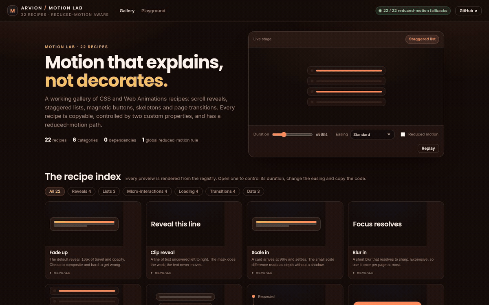
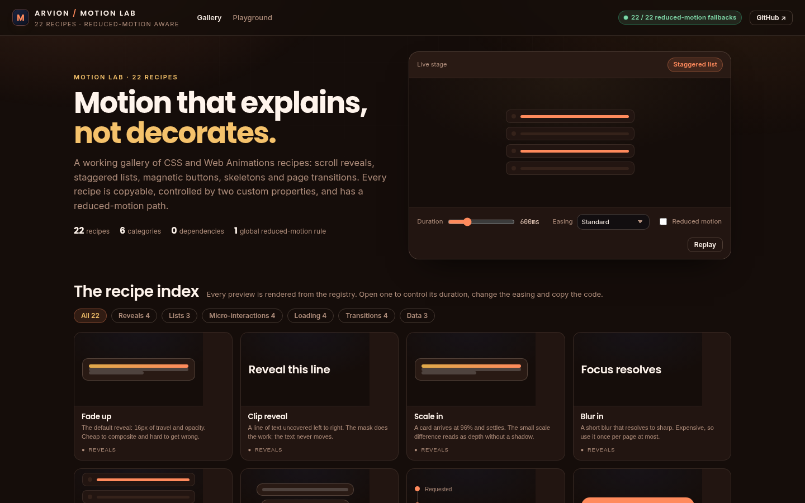
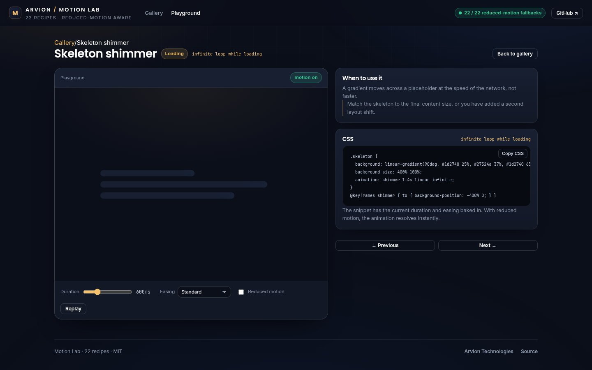

<div align="center">

</div>

<sub>Recorded from the live demo, <a href="docs/demo.mp4">MP4</a> · <a href="docs/screenshot.png">static frame</a></sub>

# Motion Lab

Twenty-two CSS animation recipes you can copy into a real product: scroll
reveals, staggered lists, magnetic buttons, skeletons, page transitions and chart
motion. Every preview is live, every snippet is copyable, and every recipe has a
reduced-motion path. No library and no build step.

[**Open the live demo**](https://arvion-technology.github.io/labs/demos/motion-lab/) · [MIT](LICENSE)

---

Most animation galleries show a looping video of a card sliding in. This one is a
working registry: the gallery, the stage, the code panel and the tests all read
the same recipe objects. The duration and easing controls change the CSS you copy,
not just the demo. Nothing here is longer than it needs to be, and nothing loops
forever without saying so.

The rule that is not optional is on the page: `prefers-reduced-motion` collapses
every animation to its final state. This is a preference, not a fallback for old
browsers.

## What it does

- **A live gallery**: 22 recipes in six categories, each rendered from its
  registry entry with a real preview rather than a thumbnail.
- **A playground**: every recipe opens with duration and easing controls, a
  replay button, a reduced-motion toggle, its trigger, its copyable CSS and an
  honest note about when not to use it.
- **Copy-ready CSS**: snippets use two custom properties (`--motion-dur`,
  `--motion-ease`), and the playground bakes the current control values into the
  code before you copy it.
- **Tasteful categories**: reveals, lists, micro-interactions, loading,
  transitions and data. Twenty-two recipes, no filler.

## Screenshots

| Gallery | Playground |
| --- | --- |
|  |  |

## Architecture

```text
26-motion-lab/
├── src/
│   ├── recipes.js    22 recipe records: summary, trigger, CSS, note, keywords
│   └── easing.js     cubic-bezier parsing and sampling, duration clamping,
│                     stagger delays, the reduced-motion rule
├── demo/
│   ├── index.html    gallery shell
│   ├── app.js        hash router, stage, controls, preview markup
│   ├── index.css     gallery layout + the 22 preview animations
│   └── arvion.css    shared brand tokens and app shell
├── test/
│   └── motion.test.js  15 node:test cases
├── docs/           screenshots
└── scripts/        serve, shot, static checks
```

The previews in `index.css` are the visual demos; the snippets in
`src/recipes.js` are the copyable versions. They are kept deliberately separate:
a demo can be a miniature mock, while the snippet has to make sense pasted into
someone else's component.

## Quickstart

```bash
git clone https://github.com/arvion-technology/motion-lab.git
cd motion-lab
npm test          # 15 tests, no dependencies, Node 20+
npm run demo      # http://localhost:4173/demo/
```

Copy a recipe from the playground, or generate the reduced-motion block once:

```css
@media (prefers-reduced-motion: reduce) {
  *, *::before, *::after {
    animation-duration: 0.001ms !important;
    animation-iteration-count: 1 !important;
    transition-duration: 0.001ms !important;
    scroll-behavior: auto !important;
  }
}
```

## How it works

**Recipes are data.** Each entry in `src/recipes.js` carries the CSS, the trigger
(IntersectionObserver, hover, route change, infinite loop), a note about the
trade-off, and search keywords. The gallery iterates the registry, so adding a
recipe means adding one object and one preview rule, not editing the page.

**Easing is sampled, not guessed.** `src/easing.js` parses a `cubic-bezier`
string, validates that the x control points stay in 0..1, and samples the curve by
bisecting the x axis. The tests pin the endpoints, check the standard curve
front-loads its motion, and confirm the spring curve overshoots above 1. The
playground uses the same values the tests check.

**Duration and easing are custom properties.** The copyable snippets reference
`var(--motion-dur)` and `var(--motion-ease)`. The playground writes those two
properties on the stage, and `buildSnippet()` bakes the current values into the
copied text. One code path, two presentations.

**Reduced motion is global and per-recipe honest.** `REDUCED_MOTION_CSS` is
exported from `src/easing.js`, printed in the gallery, and applied by the
stylesheets. The playground toggle simulates the preference without changing the
operating system setting. The notes call out where motion is expensive: blur
forces repaints, clip-path is not free on low-end phones, and a long stagger has
to be capped or the last row arrives after the user has left.

**Stagger delays are capped.** `staggerDelays(count, step, maxTotal)` scales the
step down so a forty-row list still finishes inside 600ms. A long list that takes
two seconds to appear is a loading state with extra steps.

## Tests

```bash
npm test
```

Fifteen cases on `node:test` across the two source modules:

| Area | What is checked |
| --- | --- |
| easing | parse valid/invalid curves, endpoint pinning, monotonic sampling, spring overshoot, duration clamping and formatting |
| stagger | per-item delays, total cap, empty list |
| reduced motion | the rule text and the global decision helper |
| recipes | 22 unique recipes, every category has at least three, every recipe has CSS + trigger + note + keywords, no remote assets, snippet controls |
| lookup | id lookup, category filter, keyword search |

The demo has its own static check for asset wiring and placeholder text:

```bash
node scripts/serve-check.mjs
```

## Limitations

- These are CSS-first recipes. There is no React or Web Components wrapper; the
  snippets are meant to be pasted into whatever component model you use.
- The playground controls two properties. Recipes that use their own fixed
  timing (the press squish, for example) ignore the duration slider on purpose.
- There is no timeline editor and no scroll-scrubbing demo. Scroll-driven
  animations are a separate API with their own support caveats.
- The demos are miniature mocks. A real interface needs fewer recipes than this,
  applied to the moments that actually benefit from motion.

## Project layout

```text
26-motion-lab/
├── src/
│   ├── recipes.js     22 recipe records and the snippet builder
│   └── easing.js      curve maths, controls, stagger, reduced motion
├── demo/
│   ├── index.html     gallery shell
│   ├── app.js         router, stage, controls, previews
│   ├── index.css      layout + preview animations
│   ├── arvion.css     shared brand stylesheet
│   └── fonts/         self-hosted Inter and Poppins
├── test/              motion.test.js
├── docs/              the two screenshots
└── scripts/           serve, shot, static checks
```

## Credits

Built by [Arvion Technologies](https://arviontech.net) in Kathmandu. The recipes
come from client work where a transition had to explain a state change without
slowing the interface down. MIT licensed.
